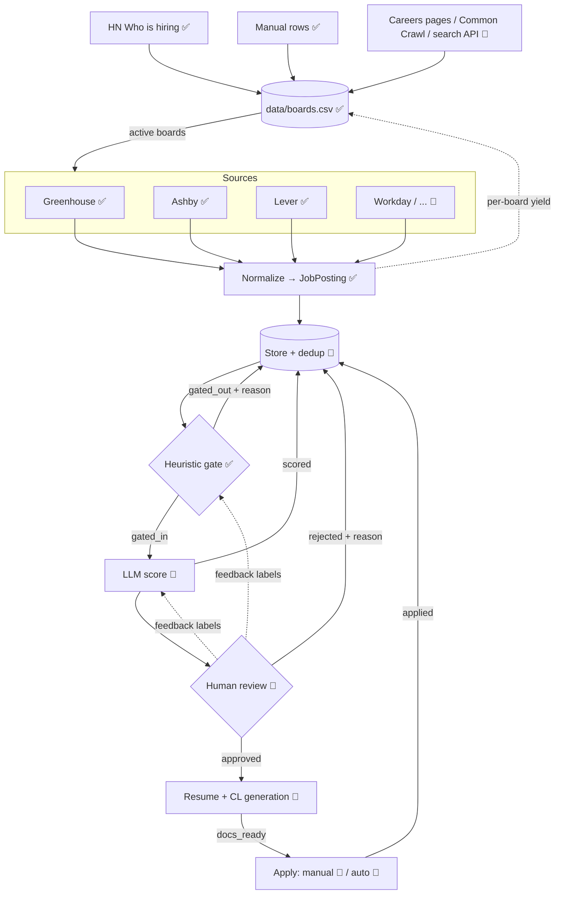

# job-funnel — Architecture

job-funnel is a staged pipeline that turns the firehose of public job postings into a short, human-approved list of applications with tailored documents. Each stage is cheaper than the next and narrows the funnel, so the expensive stages (LLM, human attention) only see what the cheap ones let through.

Legend: ✅ built · 🚧 planned

## 1. End-to-end map

```
  ┌──────────────────────────────────────────────────────────────────────────────────┐
  │ STAGE -1 Board discovery ✅ (weekly)   HN "Who is hiring" ✅ · careers pages 🚧 ·  │
  │          Common Crawl 🚧 · search API 🚧 · manual rows ✅                          │
  │          text ─► extract_board_refs ─► (ats, token) ─► validate ─► data/boards.csv │
  └───────────────┬──────────────────────────────────────────────────────────────────┘
                  ▼  active boards
                        ┌──────────────────────── SOURCES ────────────────────────┐
                        │ Greenhouse ✅   Ashby ✅   Lever ✅   Workday 🚧   ... 🚧  │
                        └───────────────┬──────────────────────────────────────────┘
                                        │ ingestor_for(board).fetch_active_jobs()  (async, ≤10 concurrent)
                                        ▼
  ┌──────────────────────────────────────────────────────────────────────────────────┐
  │ STAGE 0  Normalize ✅      raw ATS JSON ──► JobPosting (pydantic, validated)       │
  │                            invalid postings dropped + logged                      │
  └───────────────┬──────────────────────────────────────────────────────────────────┘
                  ▼
  ┌──────────────────────────────────────────────────────────────────────────────────┐
  │ STORE 🚧   SQLite: dedup on (source, external_id), status column, history         │◄──┐
  └───────────────┬──────────────────────────────────────────────────────────────────┘   │
                  ▼  only status = new                                                   │
  ┌──────────────────────────────────────────────────────────────────────────────────┐   │
  │ STAGE 1  Heuristic gate ✅   AntiKeyword → TitleTaxonomy → Location   (regex, µs)  │───┤ gated_out
  │          high recall, every drop records a reason                                │   │ + reason
  └───────────────┬──────────────────────────────────────────────────────────────────┘   │
                  ▼  ~15% survive                                                        │
  ┌──────────────────────────────────────────────────────────────────────────────────┐   │
  │ STAGE 2  LLM match / score 🚧   local vLLM, JD × candidate profile                 │───┤ scored
  │          → structured JSON {score 0-100, must-have gaps, rationale}               │   │
  └───────────────┬──────────────────────────────────────────────────────────────────┘   │
                  ▼  score ≥ threshold, ranked                                           │
  ┌──────────────────────────────────────────────────────────────────────────────────┐   │
  │ STAGE 3  Human review 🚧   queue UI / CLI: approve · reject (+ reason) · snooze    │───┤ approved /
  │          rejections become labels to calibrate Stage 1 rules & Stage 2 prompt     │   │ rejected
  └───────────────┬──────────────────────────────────────────────────────────────────┘   │
                  ▼  approved                                                            │
  ┌──────────────────────────────────────────────────────────────────────────────────┐   │
  │ STAGE 4  Resume + cover letter 🚧   LLM tailors master resume / CL template to JD  │───┤ docs_ready
  │          output: PDF/DOCX + diff vs master for a final human check                │   │
  └───────────────┬──────────────────────────────────────────────────────────────────┘   │
                  ▼                                                                      │
  ┌──────────────────────────────────────────────────────────────────────────────────┐   │
  │ STAGE 5  Apply   manual now 🚧 (open link + docs) · auto-apply later 🚧            │───┘ applied
  └──────────────────────────────────────────────────────────────────────────────────┘
```



## 2. Board discovery (why it exists)

Greenhouse, Ashby and Lever expose **per-company** endpoints only (`/boards/{token}`); there is no public cross-company search. To reach companies we've never heard of, discovery builds a registry of boards first, and ingestion then sweeps every active board; the heuristic gate does the DS filtering.

Every ATS job link embeds the board token, so any text that links to jobs is a source of boards:

| ATS | URL shapes matched by `extract_board_refs` |
|---|---|
| Greenhouse | `boards.greenhouse.io/<t>`, `job-boards(.eu).greenhouse.io/<t>`, `…/embed/job_board?for=<t>`, `boards-api.greenhouse.io/v1/boards/<t>` |
| Ashby | `jobs.ashbyhq.com/<t>`, `api.ashbyhq.com/posting-api/job-board/<t>` |
| Lever | `jobs(.eu).lever.co/<t>`, `api.lever.co/v0/postings/<t>` |

Tokens are lower-cased (all three APIs accept lowercase; Lever *only* lowercase).

| Discovery trick | Status | Notes |
|---|---|---|
| HN "Ask HN: Who is hiring?" (Algolia API) | ✅ `HNWhoIsHiringDiscoverer` | Free, monthly. 12 months (Nov 2026) → 288 boards, 258 live, mostly small companies |
| Manual rows | ✅ | Edit `data/boards.csv` (`discovered_via=manual`, `status=unverified`) |
| Careers-page fingerprinting | 🚧 | Seed domains (YC, VC portfolios) → fetch `/careers` → same regex |
| Common Crawl URL index | 🚧 | `index.commoncrawl.org/<crawl>-index?url=jobs.ashbyhq.com/&matchType=prefix`; thousands of tokens but the API often 504s → batch job with retries |
| Search API (`site:jobs.ashbyhq.com "data scientist"`) | 🚧 | Needs a paid key (Brave/SerpAPI/Google CSE) |
| LinkedIn | ✗ | No public read/search API (Job Posting API is partner-only, *writes into* LinkedIn); scraping violates ToS. Its "apply on company site" links can still be pasted through `extract_board_refs`. |

**Validation**: one cheap GET per board; 404 → `dead`, else `active` + job count (Greenhouse also returns the company's real `name`). Transient errors keep the previous status. Boards are re-validated after 7 days.

**Ranking / pruning**: each pipeline run writes `n_jobs` and `n_gated_in` back to the registry, so low-yield or empty boards can be skipped later.

```bash
uv run python -m job_funnel.discovery --hn-months 12   # weekly
uv run python -m job_funnel.pipeline                   # daily, sweeps active boards
```

## 3. Data model

| Model | Status | Key fields |
|---|---|---|
| `Board` | ✅ `boards.py` | `ats`, `token`, `company_name`, `discovered_via`, `first_seen`, `last_checked`, `status` (`unverified/active/dead`), `n_jobs`, `n_gated_in` |
| `JobPosting` | ✅ `schemas.py` | `source`, `external_id`, `title`, `company`, `board_token`, `description` (plain text), `location`, `url`, `remote: bool \| None`, `discovered_at`; property `is_remote` |
| `ScoredJob` | 🚧 | `job_key`, `score`, `must_have_gaps[]`, `rationale`, `model`, `prompt_version` |
| `ReviewDecision` | 🚧 | `job_key`, `decision`, `reason`, `reviewed_at` |
| `Application` | 🚧 | `job_key`, `resume_path`, `cover_letter_path`, `applied_at`, `channel` (manual/auto) |

Identity: a job is uniquely `(source, external_id)`. Every later stage keys off that.

`remote` is the structured flag when the source provides one (Ashby `workplaceType`); `None` means unknown and `is_remote` falls back to searching the location string for "remote".

## 4. Job lifecycle (state machine) 🚧

```
new ──gate──► gated_out                    (terminal, reason stored)
 │
 └──gate──► gated_in ──llm──► scored ──review──► rejected   (terminal, reason stored)
                                  │
                                  └──review──► approved ──gen──► docs_ready ──► applied
```

Rules: transitions only move forward; a re-ingested job that already exists keeps its state (dedup); changing a rule or prompt version can re-queue `gated_out` / `scored` jobs explicitly.

## 5. Module map

| Path | Responsibility |
|---|---|
| `src/job_funnel/schemas.py` | Shared `JobPosting` contract between all stages |
| `src/job_funnel/text.py` | `clean_html` — HTML (incl. entity-escaped) → plain text |
| `src/job_funnel/base_ingestor.py` | `BaseIngestor`: HTTP fetch, injectable `httpx.AsyncClient`, calls `_parse` |
| `src/job_funnel/greenhouse_ingestor.py` | Greenhouse Job Board API → `JobPosting` |
| `src/job_funnel/ashby_ingestor.py` | Ashby Posting API → `JobPosting` (skips unlisted, structured remote) |
| `src/job_funnel/lever_ingestor.py` | Lever Postings API (bare JSON list) → `JobPosting` |
| `src/job_funnel/boards.py` | `Board`, `BoardRegistry` (CSV), `extract_board_refs`, `validate_board(s)`, `ingestor_for` |
| `src/job_funnel/discovery.py` | `Discoverer` interface, `HNWhoIsHiringDiscoverer`, `run_discovery`, discovery CLI |
| `data/boards.csv` | The board registry (tracked in git, hand-editable) |
| `src/job_funnel/heuristic_gate.py` | `FilterRule` interface, 3 rules, short-circuit `HeuristicGate` |
| `src/job_funnel/pipeline.py` | `build_ingestors` (from registry), `ingest_all` (bounded concurrency, fault-tolerant), `apply_gate`, `record_board_stats`, CLI `main` |
| `tests/` | Offline unit tests (`httpx.MockTransport` + JSON fixtures) |
| `notebooks/01_getting_started.ipynb` | Onboarding tutorial |
| 🚧 `store.py`, `scorer.py`, `review/`, `docgen/`, `apply/` | Planned stages |

## 6. Extension points

**Add an ATS** — subclass `BaseIngestor`, set `source`, implement `api_url` and `_parse(payload) -> list[JobPosting]` (see `lever_ingestor.py`), register it in `boards.INGESTORS`, add its URL shapes to `boards.ATS_PATTERNS`, add a fixture + test.

**Add a discovery source** — subclass `discovery.Discoverer`, implement `async discover(client) -> set[(ats, token)]` (usually: fetch text, run `extract_board_refs`), add it to the list in `discovery.main`.

**Add a heuristic rule** — subclass `FilterRule`, return `(True, None)` or `(False, "<reason>")`, insert it into the rule list (cheapest / most selective first).

## 7. Design principles

1. **Cheap before expensive.** Regex (µs) → local LLM (s) → human (min). Each stage should be tuned for high recall; precision comes from the next stage.
2. **Every drop has a reason.** Rejections are data: they're how we audit false negatives and tune rules/prompts.
3. **One contract.** Sources only produce `JobPosting`; downstream stages never see ATS-specific JSON.
4. **Fault isolation.** One broken source or one malformed posting never kills a run.
5. **Human gate before anything outward-facing.** Nothing is sent to an employer without explicit approval, even once auto-apply exists.
6. **Offline-testable.** All network I/O goes through an injectable client.

## 8. Open questions

- Store: SQLite (simple, local) vs Postgres (if run as a service)? Leaning SQLite.
- Stage 2 model choice & hardware: vLLM needs a CUDA GPU; need a hosted-API fallback?
- Candidate profile format (structured YAML vs free-text resume) used by Stage 2 and Stage 4.
- Review UI: CLI, notebook, or a small web app (Streamlit/FastAPI)?
- Discovery beyond HN: which next — careers-page scan from a YC/VC seed list, or Common Crawl batch?
- Greenhouse title-first fetch: list jobs without `?content=true`, gate on title, fetch `/jobs/{id}` content only for survivors (cuts bandwidth ~10×).
- Cross-company keyword search via a paid Google-for-Jobs reseller (SerpAPI / JSearch) as an extra ingestor?
- Auto-apply: per-ATS form automation, ToS and rate limits.
