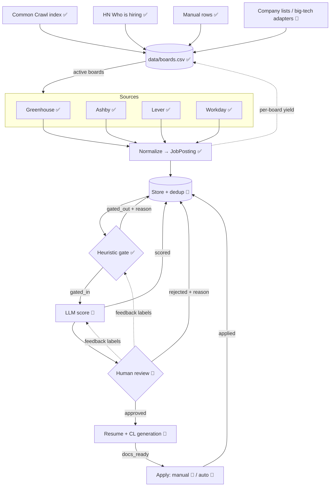

# job-funnel — Architecture

job-funnel is a staged pipeline that turns the firehose of public job postings into a short, human-approved list of applications with tailored documents. Each stage is cheaper than the next and narrows the funnel, so the expensive stages (LLM, human attention) only see what the cheap ones let through.

Legend: ✅ built · 🚧 planned

## 1. End-to-end map

```
  ┌──────────────────────────────────────────────────────────────────────────────────┐
  │ STAGE -1 Board discovery ✅ (weekly)   Common Crawl index ✅ · HN "Who is hiring" ✅│
  │          manual rows ✅ · company lists + resolver 🚧 · big-tech adapters 🚧        │
  │          text ─► extract_board_refs ─► (ats, token) ─► validate ─► data/boards.csv │
  └───────────────┬──────────────────────────────────────────────────────────────────┘
                  ▼  active boards
                        ┌──────────────────────── SOURCES ────────────────────────┐
                        │ Greenhouse ✅   Ashby ✅   Lever ✅   Workday ✅   ... 🚧  │
                        └───────────────┬──────────────────────────────────────────┘
                                        │ ingestor_for(board).fetch_active_jobs()  (async, ≤20 concurrent,
                                        │  shared client, retries; title-first for Greenhouse/Workday)
                                        ▼
  ┌──────────────────────────────────────────────────────────────────────────────────┐
  │ STAGE 0  Normalize ✅      raw ATS JSON ──► JobPosting (pydantic, validated)       │
  │                            invalid postings dropped + logged                      │
  └───────────────┬──────────────────────────────────────────────────────────────────┘
                  ▼
  ┌──────────────────────────────────────────────────────────────────────────────────┐
  │ STORE 🚧   SQLite: dedup on (source, external_id), status column, history         │◄──┐
  └───────────────┬──────────────────────────────────────────────────────────────────┘   │
                  ▼  only status = new                                                   │
  ┌──────────────────────────────────────────────────────────────────────────────────┐   │
  │ STAGE 1  Heuristic gate ✅   AntiKeyword → TitleTaxonomy → Location   (regex, µs)  │───┤ gated_out
  │          high recall, every drop records a reason                                │   │ + reason
  └───────────────┬──────────────────────────────────────────────────────────────────┘   │
                  ▼  ~15% survive                                                        │
  ┌──────────────────────────────────────────────────────────────────────────────────┐   │
  │ STAGE 2  LLM match / score 🚧   local vLLM, JD × candidate profile                 │───┤ scored
  │          → structured JSON {score 0-100, must-have gaps, rationale}               │   │
  └───────────────┬──────────────────────────────────────────────────────────────────┘   │
                  ▼  score ≥ threshold, ranked                                           │
  ┌──────────────────────────────────────────────────────────────────────────────────┐   │
  │ STAGE 3  Human review 🚧   queue UI / CLI: approve · reject (+ reason) · snooze    │───┤ approved /
  │          rejections become labels to calibrate Stage 1 rules & Stage 2 prompt     │   │ rejected
  └───────────────┬──────────────────────────────────────────────────────────────────┘   │
                  ▼  approved                                                            │
  ┌──────────────────────────────────────────────────────────────────────────────────┐   │
  │ STAGE 4  Resume + cover letter 🚧   LLM tailors master resume / CL template to JD  │───┤ docs_ready
  │          output: PDF/DOCX + diff vs master for a final human check                │   │
  └───────────────┬──────────────────────────────────────────────────────────────────┘   │
                  ▼                                                                      │
  ┌──────────────────────────────────────────────────────────────────────────────────┐   │
  │ STAGE 5  Apply   manual now 🚧 (open link + docs) · auto-apply later 🚧            │───┘ applied
  └──────────────────────────────────────────────────────────────────────────────────┘
```



## 2. Board discovery (why it exists)

Greenhouse, Ashby, Lever and Workday expose **per-company** endpoints only; there is no public cross-company search. To reach companies we've never heard of, discovery builds a registry of boards first, and ingestion then sweeps every active board; the heuristic gate does the DS filtering.

Every ATS job link embeds the board token, so any text (or crawl index) that contains job URLs is a source of boards:

| ATS | URL shapes matched by `extract_board_refs` | Token |
|---|---|---|
| Greenhouse | `boards.greenhouse.io/<t>`, `job-boards(.eu).greenhouse.io/<t>`, `…/embed/job_board?for=<t>`, `boards-api.greenhouse.io/v1/boards/<t>` | `<t>` |
| Ashby | `jobs.ashbyhq.com/<t>`, `api.ashbyhq.com/posting-api/job-board/<t>` | `<t>` |
| Lever | `jobs(.eu).lever.co/<t>`, `api.lever.co/v0/postings/<t>` | `<t>` |
| Workday | `<tenant>.wd<N>.myworkdayjobs.com/[<locale>/]<site>` | `tenant\|wdN\|site` |

Tokens are lower-cased (all APIs accept lowercase; Lever and Workday tenants *only* lowercase). Job UUIDs, `%20`-encoded names and other junk are rejected by `is_plausible_token`.

### Sourcing layers (coverage by company segment)

Measured 2026-11-03 against a 42-company benchmark of well-known DS employers: HN alone covered **3/42** (startup-biased). Of the rest, 20 were simply undiscovered GH/Ashby/Lever boards, ~8 are on Workday, and the FAANG-scale ones run in-house sites.

| Layer | Segment | Status | Notes |
|---|---|---|---|
| **A. Common Crawl index** | startups → mid → Workday enterprises | ✅ `CommonCrawlDiscoverer` | Reads the CC URL index for all ATS hosts. One crawl ≈ 8,000 boards (≈3.9k GH, 2.9k Workday sites, 1k Ashby, 270 Lever); combine 2–3 crawls. |
| HN "Who is hiring" | new startups (freshness) | ✅ `HNWhoIsHiringDiscoverer` | Monthly; ~290 boards / 12 months |
| Manual rows | must-haves | ✅ | Edit `data/boards.csv` (`status=unverified`) |
| **B. Company lists → resolver** | mid / large by name | 🚧 | DOL H-1B LCA data (every employer filing *Data Scientist* visas, ranked) + SEC EDGAR tickers (10.4k public cos) → slug guessing + Workday tenant matching |
| **C. Big-tech adapters** | in-house career sites | 🚧 | Amazon (`amazon.jobs/en/search.json` ✅ probed), Netflix/Eightfold ✅ probed; Google/Meta/Apple/Microsoft need custom adapters |
| **D. Coverage report** | measurement | 🚧 | Benchmark % covered + misses, tracked over time |
| Search API / aggregators | catch-all | ✗ (free-only for now) | SerpAPI Google Jobs, Adzuna |
| LinkedIn | — | ✗ | No public read/search API (Job Posting API is partner-only, *writes into* LinkedIn); scraping violates ToS |

### How the Common Crawl discoverer works

The public CDX server (`index.commoncrawl.org`) is overloaded and 504s constantly, so we read the same index directly from `data.commoncrawl.org` (S3-backed, supports HTTP Range):

```
cluster.idx (~100MB/crawl, cached)          cdx-000NN.gz shards (~GBs, never downloaded whole)
  "co,lever,jobs)/... ts  cdx-00012.gz  off  len"  ──range GET──►  one ~3,000-line gzip block
  sorted by SURT key → bisect each ATS prefix → ~60 blocks/crawl → ATS URLs → extract_board_refs
```

Blocks and `cluster.idx` are cached under `data/cache/commoncrawl/` (gitignored): reruns are instant, interrupted runs resume. One crawl takes ~10 s.

### Validation & lifecycle

One cheap request per board (Greenhouse job list, Workday `POST …/jobs {"limit":1}`, Ashby/Lever board fetch). `404/410/422` → `dead`; reachable → `active`, or `dormant` after 3 consecutive empty checks (skipped by the pipeline). Transient errors keep the previous status. Re-validation schedule: new now, active 7 d, dormant 30 d, dead 90 d. Greenhouse boards get the real company name from the job list.

### Ingestion at scale

- One shared `httpx.AsyncClient`, ≤ 20 boards in flight, retries with exponential backoff on 429/5xx/connection errors (`base_ingestor.request_with_retry`).
- **Title-first**: Greenhouse lists titles without `?content=true` and Workday runs server-side keyword search (`workday_ingestor.SEARCH_TERMS`); both fetch full descriptions only for titles passing `pipeline.title_prefilter`.
- Each run writes `n_jobs` / `n_gated_in` back to the registry for ranking.

```bash
uv run python -m job_funnel.discovery --common-crawl --cc-crawls 3   # weekly (HN included by default)
uv run python -m job_funnel.pipeline                                 # daily, sweeps active boards
```

## 3. Data model

| Model | Status | Key fields |
|---|---|---|
| `Board` | ✅ `boards.py` | `ats`, `token`, `company_name`, `discovered_via`, `first_seen`, `last_checked`, `status` (`unverified/active/dormant/dead`), `n_jobs`, `n_gated_in`, `zero_streak` |
| `JobPosting` | ✅ `schemas.py` | `source`, `external_id`, `title`, `company`, `board_token`, `description` (plain text), `location`, `url`, `remote: bool \| None`, `discovered_at`; property `is_remote` |
| `ScoredJob` | 🚧 | `job_key`, `score`, `must_have_gaps[]`, `rationale`, `model`, `prompt_version` |
| `ReviewDecision` | 🚧 | `job_key`, `decision`, `reason`, `reviewed_at` |
| `Application` | 🚧 | `job_key`, `resume_path`, `cover_letter_path`, `applied_at`, `channel` (manual/auto) |

Identity: a job is uniquely `(source, external_id)`. Every later stage keys off that.

`remote` is the structured flag when the source provides one (Ashby `workplaceType`); `None` means unknown and `is_remote` falls back to searching the location string for "remote".

## 4. Job lifecycle (state machine) 🚧

```
new ──gate──► gated_out                    (terminal, reason stored)
 │
 └──gate──► gated_in ──llm──► scored ──review──► rejected   (terminal, reason stored)
                                  │
                                  └──review──► approved ──gen──► docs_ready ──► applied
```

Rules: transitions only move forward; a re-ingested job that already exists keeps its state (dedup); changing a rule or prompt version can re-queue `gated_out` / `scored` jobs explicitly.

## 5. Module map

| Path | Responsibility |
|---|---|
| `src/job_funnel/schemas.py` | Shared `JobPosting` contract between all stages |
| `src/job_funnel/text.py` | `clean_html` — HTML (incl. entity-escaped) → plain text |
| `src/job_funnel/base_ingestor.py` | `BaseIngestor`: HTTP fetch, injectable `httpx.AsyncClient`, calls `_parse` |
| `src/job_funnel/greenhouse_ingestor.py` | Greenhouse Job Board API → `JobPosting` |
| `src/job_funnel/ashby_ingestor.py` | Ashby Posting API → `JobPosting` (skips unlisted, structured remote) |
| `src/job_funnel/lever_ingestor.py` | Lever Postings API (bare JSON list) → `JobPosting` |
| `src/job_funnel/workday_ingestor.py` | Workday career sites: keyword search + per-job detail → `JobPosting` |
| `src/job_funnel/boards.py` | `Board`, `BoardRegistry` (CSV), `extract_board_refs`, `validate_board(s)`, `ingestor_for` |
| `src/job_funnel/discovery.py` | `Discoverer` interface, `CommonCrawlDiscoverer`, `HNWhoIsHiringDiscoverer`, `run_discovery`, discovery CLI |
| `data/boards.csv` | The board registry (tracked in git, hand-editable) |
| `src/job_funnel/heuristic_gate.py` | `FilterRule` interface, 3 rules, short-circuit `HeuristicGate` |
| `src/job_funnel/pipeline.py` | `build_ingestors` (from registry), `ingest_all` (bounded concurrency, fault-tolerant), `apply_gate`, `record_board_stats`, CLI `main` |
| `tests/` | Offline unit tests (`httpx.MockTransport` + JSON fixtures) |
| `notebooks/01_getting_started.ipynb` | Onboarding tutorial |
| 🚧 `store.py`, `scorer.py`, `review/`, `docgen/`, `apply/` | Planned stages |

## 6. Extension points

**Add an ATS** — subclass `BaseIngestor`, set `source`, implement `api_url` and `_parse(payload) -> list[JobPosting]` (see `lever_ingestor.py`), register it in `boards.INGESTORS`, add its URL shapes to `boards.ATS_PATTERNS`, add a fixture + test.

**Add a discovery source** — subclass `discovery.Discoverer`, implement `async discover(client) -> set[(ats, token)]` (usually: fetch text, run `extract_board_refs`), add it to the list in `discovery.main`.

**Add a heuristic rule** — subclass `FilterRule`, return `(True, None)` or `(False, "<reason>")`, insert it into the rule list (cheapest / most selective first).

## 7. Design principles

1. **Cheap before expensive.** Regex (µs) → local LLM (s) → human (min). Each stage should be tuned for high recall; precision comes from the next stage.
2. **Every drop has a reason.** Rejections are data: they're how we audit false negatives and tune rules/prompts.
3. **One contract.** Sources only produce `JobPosting`; downstream stages never see ATS-specific JSON.
4. **Fault isolation.** One broken source or one malformed posting never kills a run.
5. **Human gate before anything outward-facing.** Nothing is sent to an employer without explicit approval, even once auto-apply exists.
6. **Offline-testable.** All network I/O goes through an injectable client.

## 8. Open questions

- Store: SQLite (simple, local) vs Postgres (if run as a service)? Leaning SQLite.
- Stage 2 model choice & hardware: vLLM needs a CUDA GPU; need a hosted-API fallback?
- Candidate profile format (structured YAML vs free-text resume) used by Stage 2 and Stage 4.
- Review UI: CLI, notebook, or a small web app (Streamlit/FastAPI)?
- Layer B/C/D next: H-1B + SEC company lists with a name→board resolver, big-tech adapters, and a coverage report.
- Workday tenants often expose several sites (internal/external/regional) with overlapping postings → cross-board dedup belongs in the Store stage.
- Cross-company keyword search via a paid Google-for-Jobs reseller (SerpAPI / JSearch) as an extra ingestor?
- Auto-apply: per-ATS form automation, ToS and rate limits.
