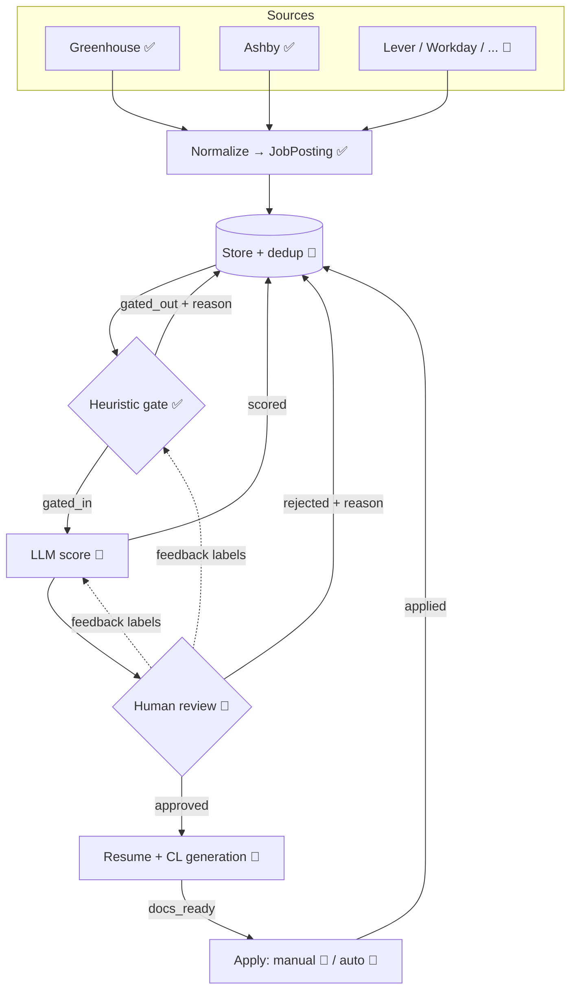

# job-funnel — Architecture

job-funnel is a staged pipeline that turns the firehose of public job postings into a short, human-approved list of applications with tailored documents. Each stage is cheaper than the next and narrows the funnel, so the expensive stages (LLM, human attention) only see what the cheap ones let through.

Legend: ✅ built · 🚧 planned

## 1. End-to-end map

```
                        ┌──────────────────────── SOURCES ────────────────────────┐
                        │ Greenhouse ✅   Ashby ✅   Lever 🚧   Workday 🚧   ... 🚧  │
                        └───────────────┬──────────────────────────────────────────┘
                                        │ BaseIngestor.fetch_active_jobs()  (async, concurrent)
                                        ▼
  ┌──────────────────────────────────────────────────────────────────────────────────┐
  │ STAGE 0  Normalize ✅      raw ATS JSON ──► JobPosting (pydantic, validated)       │
  │                            invalid postings dropped + logged                      │
  └───────────────┬──────────────────────────────────────────────────────────────────┘
                  ▼
  ┌──────────────────────────────────────────────────────────────────────────────────┐
  │ STORE 🚧   SQLite: dedup on (source, external_id), status column, history         │◄──┐
  └───────────────┬──────────────────────────────────────────────────────────────────┘   │
                  ▼  only status = new                                                   │
  ┌──────────────────────────────────────────────────────────────────────────────────┐   │
  │ STAGE 1  Heuristic gate ✅   AntiKeyword → TitleTaxonomy → Location   (regex, µs)  │───┤ gated_out
  │          high recall, every drop records a reason                                │   │ + reason
  └───────────────┬──────────────────────────────────────────────────────────────────┘   │
                  ▼  ~15% survive                                                        │
  ┌──────────────────────────────────────────────────────────────────────────────────┐   │
  │ STAGE 2  LLM match / score 🚧   local vLLM, JD × candidate profile                 │───┤ scored
  │          → structured JSON {score 0-100, must-have gaps, rationale}               │   │
  └───────────────┬──────────────────────────────────────────────────────────────────┘   │
                  ▼  score ≥ threshold, ranked                                           │
  ┌──────────────────────────────────────────────────────────────────────────────────┐   │
  │ STAGE 3  Human review 🚧   queue UI / CLI: approve · reject (+ reason) · snooze    │───┤ approved /
  │          rejections become labels to calibrate Stage 1 rules & Stage 2 prompt     │   │ rejected
  └───────────────┬──────────────────────────────────────────────────────────────────┘   │
                  ▼  approved                                                            │
  ┌──────────────────────────────────────────────────────────────────────────────────┐   │
  │ STAGE 4  Resume + cover letter 🚧   LLM tailors master resume / CL template to JD  │───┤ docs_ready
  │          output: PDF/DOCX + diff vs master for a final human check                │   │
  └───────────────┬──────────────────────────────────────────────────────────────────┘   │
                  ▼                                                                      │
  ┌──────────────────────────────────────────────────────────────────────────────────┐   │
  │ STAGE 5  Apply   manual now 🚧 (open link + docs) · auto-apply later 🚧            │───┘ applied
  └──────────────────────────────────────────────────────────────────────────────────┘
```



## 2. Data model

| Model | Status | Key fields |
|---|---|---|
| `JobPosting` | ✅ `schemas.py` | `source`, `external_id`, `title`, `company`, `description` (plain text), `location`, `url`, `remote: bool \| None`, `discovered_at`; property `is_remote` |
| `ScoredJob` | 🚧 | `job_key`, `score`, `must_have_gaps[]`, `rationale`, `model`, `prompt_version` |
| `ReviewDecision` | 🚧 | `job_key`, `decision`, `reason`, `reviewed_at` |
| `Application` | 🚧 | `job_key`, `resume_path`, `cover_letter_path`, `applied_at`, `channel` (manual/auto) |

Identity: a job is uniquely `(source, external_id)`. Every later stage keys off that.

`remote` is the structured flag when the source provides one (Ashby `workplaceType`); `None` means unknown and `is_remote` falls back to searching the location string for "remote".

## 3. Job lifecycle (state machine) 🚧

```
new ──gate──► gated_out                    (terminal, reason stored)
 │
 └──gate──► gated_in ──llm──► scored ──review──► rejected   (terminal, reason stored)
                                  │
                                  └──review──► approved ──gen──► docs_ready ──► applied
```

Rules: transitions only move forward; a re-ingested job that already exists keeps its state (dedup); changing a rule or prompt version can re-queue `gated_out` / `scored` jobs explicitly.

## 4. Module map

| Path | Responsibility |
|---|---|
| `src/job_funnel/schemas.py` | Shared `JobPosting` contract between all stages |
| `src/job_funnel/text.py` | `clean_html` — HTML (incl. entity-escaped) → plain text |
| `src/job_funnel/base_ingestor.py` | `BaseIngestor`: HTTP fetch, injectable `httpx.AsyncClient`, calls `_parse` |
| `src/job_funnel/greenhouse_ingestor.py` | Greenhouse Job Board API → `JobPosting` |
| `src/job_funnel/ashby_ingestor.py` | Ashby Posting API → `JobPosting` (skips unlisted, structured remote) |
| `src/job_funnel/heuristic_gate.py` | `FilterRule` interface, 3 rules, short-circuit `HeuristicGate` |
| `src/job_funnel/pipeline.py` | `ingest_all` (concurrent, fault-tolerant), `apply_gate`, CLI `main` |
| `tests/` | Offline unit tests (`httpx.MockTransport` + JSON fixtures) |
| `notebooks/01_getting_started.ipynb` | Onboarding tutorial |
| 🚧 `store.py`, `scorer.py`, `review/`, `docgen/`, `apply/` | Planned stages |

## 5. Extension points

**Add a source** — subclass `BaseIngestor`, set `source`, implement `api_url` and `_parse(payload) -> list[JobPosting]`, add a fixture + test, register it in `pipeline.main`.

```python
class LeverIngestor(BaseIngestor):
    source = "lever_api"

    @property
    def api_url(self) -> str:
        return f"https://api.lever.co/v0/postings/{self.company_token}?mode=json"

    def _parse(self, payload): ...
```

**Add a heuristic rule** — subclass `FilterRule`, return `(True, None)` or `(False, "<reason>")`, insert it into the rule list (cheapest / most selective first).

## 6. Design principles

1. **Cheap before expensive.** Regex (µs) → local LLM (s) → human (min). Each stage should be tuned for high recall; precision comes from the next stage.
2. **Every drop has a reason.** Rejections are data: they're how we audit false negatives and tune rules/prompts.
3. **One contract.** Sources only produce `JobPosting`; downstream stages never see ATS-specific JSON.
4. **Fault isolation.** One broken source or one malformed posting never kills a run.
5. **Human gate before anything outward-facing.** Nothing is sent to an employer without explicit approval, even once auto-apply exists.
6. **Offline-testable.** All network I/O goes through an injectable client.

## 7. Open questions

- Store: SQLite (simple, local) vs Postgres (if run as a service)? Leaning SQLite.
- Stage 2 model choice & hardware: vLLM needs a CUDA GPU; need a hosted-API fallback?
- Candidate profile format (structured YAML vs free-text resume) used by Stage 2 and Stage 4.
- Review UI: CLI, notebook, or a small web app (Streamlit/FastAPI)?
- Company discovery: where do board tokens come from (curated list vs crawler)?
- Auto-apply: per-ATS form automation, ToS and rate limits.
